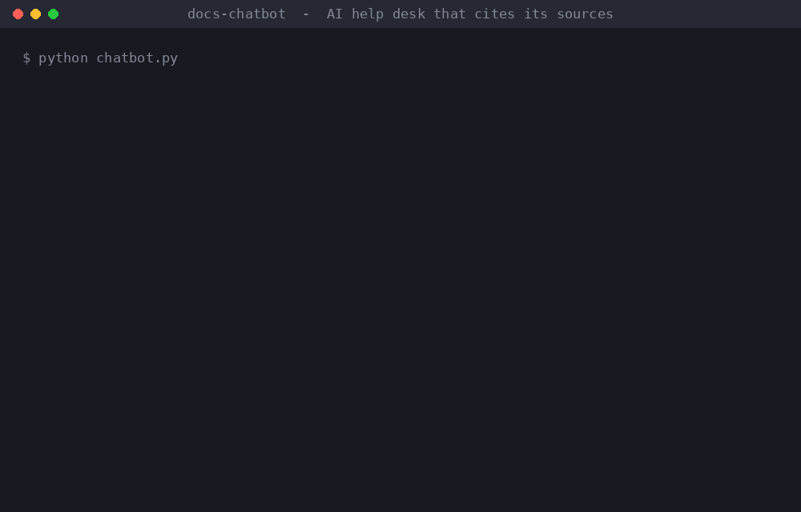

# Docs Chatbot: AI FAQ Bot for Your Own Help Docs

A Python customer-support chatbot that answers questions from a company's own documentation and **always cites where each answer came from**. If the docs don't cover a question, it says so and offers a hand-off to a human instead of making something up.

The sample knowledge base is a fictional internet provider (billing, outages, plans). Point the bot at your own folder of Markdown files and it works the same way.



## Example

```text
You: my wifi is really slow

Bot: Slow Wi-Fi is usually caused by distance from the router, walls, or interference.
Place the router in a central, open spot, use the 5 GHz network for devices close to
the router, and restart the router weekly. Plans above 500 Mbps need a Wi-Fi 6 router
to reach full speed.

Sources: outages.md > Why is my Wi-Fi slow?

You: who won the super bowl

Bot: I couldn't find that in our help docs. Would you like me to connect you with a
support agent?
```

## How it works

1. **Load**: each Markdown file in `docs/` is split into sections at `## ` headings.
2. **Retrieve**: the question is matched to the best sections with TF-IDF over words and character n-grams (scikit-learn). This step runs fully offline.
3. **Answer**:
   - **Offline mode** (no API key): replies with the best-matching section, plus a close runner-up if there is one.
   - **AI mode**: set `ANTHROPIC_API_KEY` or `OPENAI_API_KEY` and the model writes a short, friendly answer using **only** the top 3 retrieved sections.
4. **Guardrail**: if nothing scores above the relevance threshold, the bot falls back to a human hand-off.

## Quick start

```bash
pip install -r requirements.txt
python chatbot.py                                   # interactive chat
python chatbot.py --ask "Is there a late fee?"      # one question
python chatbot.py --docs path/to/your/docs          # your own docs

export ANTHROPIC_API_KEY=...    # or OPENAI_API_KEY=... to turn on AI mode
export CHATBOT_MODEL=...        # optional model override
```

## Tests

The tests run offline with no API keys. They cover retrieval accuracy on 10 real-style questions, the off-topic fallback, and the AI-mode request format.

```bash
python -m pytest -q
```

## Adapting it

- **Your content**: drop Markdown files into a folder, one `## Question or topic` per section. Exported help-center articles, FAQ pages, or policy docs all work.
- **Your channel**: `DocsChatbot().answer(question)` returns `{"answer", "sources", "mode"}`, so it plugs into a website widget, Slack, Telegram, or a support inbox.
- **Live data**: add a lookup step before answering, for example an account's balance or an outage by ZIP code. That's what I built for a production support bot during my AI engineering internship at K2view.

## Tech

Python 3.10+, scikit-learn, pytest. AI mode calls the Anthropic or OpenAI API using only the Python standard library.
